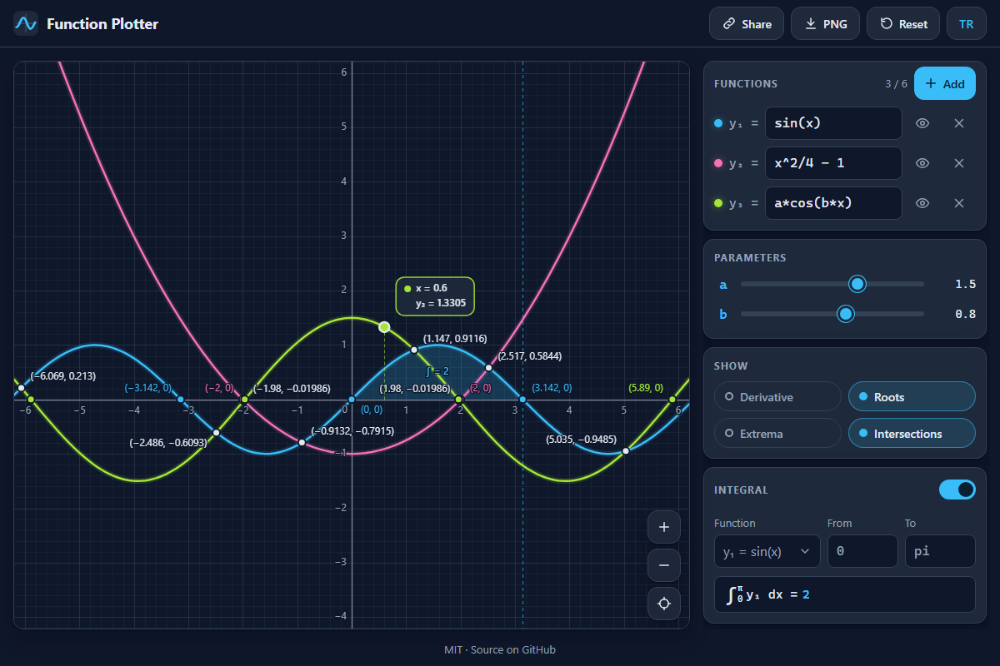

# Function Plotter - graph y = f(x) and explore it: derivatives, roots, extrema, intersections and integrals

[](#tests)
[](LICENSE)

**▶ Open the app: https://celaldrg.github.io/function-plotter/**



## Features

- Up to six functions at once, each with its own colour, a visibility toggle and live error messages that point at the mistake ("Unknown name "foo" at position 3").
- Its own expression parser: `+ - * / ^`, implicit products (`2x`, `3sin(x)`, `(x+1)(x-1)`), 23 functions (`sin`, `cos`, `tan`, `asin`, `sqrt`, `ln`, `log`, `abs`, `floor`, `min`, `max`, `mod`, ...) and the constants `pi` and `e`. No `eval`.
- Parameters `a`, `b` and `c`: their sliders appear as soon as an expression uses them.
- Symbolic derivative, drawn dashed, with its simplified formula under the function.
- Roots, local extrema and intersections, found numerically (Brent's method) and labelled on the plot.
- Definite integral with the area shaded (adaptive Simpson). An integral across a pole is reported as not computable instead of showing a wrong number.
- Trace: hover or tap near a curve to read x and y.
- Table of values with any start and step.
- Pan, zoom and pinch, equal units on both axes, sharp lines on high-DPI screens, adaptive sampling that breaks curves at asymptotes.
- Share link (the whole plot lives in the URL hash) and PNG export with a legend.
- English and Turkish interface; the last plot and the language are remembered.
- No dependencies, no build step, no network requests: plain HTML, CSS and ES modules.

## How to use

Type a function into a row, for example `x^2/4 - 1`. Enter jumps to the next row, or adds one after the last. Use the Show chips for the derivative, roots, extrema and intersections, and switch on Integral to shade an area between two bounds (bounds accept `pi/2`, `-1.5`, `2e3`).

| | Mouse and keyboard | Touch |
| --- | --- | --- |
| Pan | drag, or the arrow keys | drag with one finger |
| Zoom | scroll wheel (around the pointer), `+` and `-` | pinch with two fingers |
| Reset the view | `0`, or the target button | the target button |
| Trace | hover near a curve | tap near a curve |

Keyboard shortcuts work whenever the focus is not in a form field. The `+`, `-` and target buttons in the corner of the plot do the same on any device.

## Run locally

ES modules need `http://`, not `file://`, so use any static server from the project folder:

```sh
npx serve .
```

Then open the address it prints. Add `?demo` to the URL for the sample plot from the screenshot.

## Tests

```sh
node --test
```

Node 22 or newer, no dependencies. The tests cover the tokenizer and parser (precedence, implicit products, error codes and positions), the symbolic derivative and simplification (checked against finite differences), adaptive sampling across poles and jumps, roots, extrema, intersections and integrals, tick steps and labels, viewport maths (pan, zoom, fit), the plotter state with its URL-hash round trip and `?demo`, the translations and the storage fallbacks.

## Project structure

```
index.html          page layout
style.css           dark theme, mobile-first layout
src/
  tokenizer.js      text -> tokens, ParseError codes
  parser.js         tokens -> expression tree (recursive descent)
  ast.js            tree helpers and printing
  functions.js      built-in functions, constants, parameters
  compile.js        tree -> fast JavaScript closure
  derivative.js     symbolic derivative
  simplify.js       algebraic clean-up of trees
  sampling.js       adaptive sampling, split at discontinuities
  analysis.js       roots, extrema, intersections, integrals, tables
  ticks.js          nice tick steps and number formatting
  viewport.js       visible window: pan, zoom, fit, pixels -> world
  plotter.js        app state, derived data, URL-hash codec, demo
  render.js         canvas drawing
  gestures.js       pointer, pinch and wheel input
  panel.js          side panel controls
  i18n.js           English and Turkish strings
  storage.js        safe localStorage access
  dom.js            DOM helpers and icons
  main.js           wiring
test/               node:test suites
```

## License

[MIT](LICENSE) © 2026 Celalettin Durgaç

---

## Türkçe

Fonksiyon Çizici: y = f(x) grafiğini tarayıcıda çizin ve inceleyin; türev, kökler, ekstremumlar, kesişimler ve integraller.

**▶ Uygulamayı aç: https://celaldrg.github.io/function-plotter/**

### Özellikler

- Aynı anda altı fonksiyona kadar; her birinin kendi rengi, görünürlük düğmesi ve hatanın yerini gösteren canlı hata mesajı var ("3. konumda bilinmeyen ad: "foo"").
- Kendi ifade ayrıştırıcısı: `+ - * / ^`, örtük çarpım (`2x`, `3sin(x)`, `(x+1)(x-1)`), 23 fonksiyon (`sin`, `cos`, `tan`, `asin`, `sqrt`, `ln`, `log`, `abs`, `floor`, `min`, `max`, `mod`, ...) ve `pi`, `e` sabitleri. `eval` yok.
- `a`, `b` ve `c` parametreleri: bir ifade kullandığı anda kaydırıcıları çıkar.
- Sembolik türev: kesikli çizgiyle çizilir, sadeleştirilmiş formülü fonksiyonun altında görünür.
- Kökler, yerel ekstremumlar ve kesişimler sayısal olarak bulunur (Brent yöntemi) ve grafikte etiketlenir.
- Belirli integral, alanı taranmış olarak (uyarlamalı Simpson). Bir kutup noktasını aşan integral yanlış bir sayı yerine "hesaplanamadı" olarak bildirilir.
- İzleme: x ve y değerini okumak için eğrinin yakınına gelin ya da dokunun.
- İstenen başlangıç ve adımla değer tablosu.
- Kaydırma, yakınlaştırma ve iki parmakla yakınlaştırma; iki eksende eşit birim, yüksek DPI ekranlarda keskin çizgi, asimptotlarda eğriyi bölen uyarlamalı örnekleme.
- Paylaşım bağlantısı (tüm grafik URL'deki # kısmında saklanır) ve açıklamalı PNG dışa aktarma.
- İngilizce ve Türkçe arayüz; son grafik ve dil hatırlanır.
- Bağımlılık yok, derleme adımı yok, ağ isteği yok: sade HTML, CSS ve ES modülleri.

### Nasıl kullanılır

Bir satıra fonksiyon yazın, örneğin `x^2/4 - 1`. Enter sonraki satıra geçer, son satırdaysa yeni satır ekler. Türev, kökler, ekstremumlar ve kesişimler için Göster düğmelerini kullanın; iki sınır arasındaki alanı taramak için İntegral'i açın (sınırlar `pi/2`, `-1.5`, `2e3` gibi değerler kabul eder).

| | Fare ve klavye | Dokunmatik |
| --- | --- | --- |
| Kaydırma | sürükleyin ya da ok tuşları | tek parmakla sürükleyin |
| Yakınlaştırma | fare tekerleği (imlecin çevresinde), `+` ve `-` | iki parmakla sıkıştırın |
| Görünümü sıfırlama | `0` ya da hedef düğmesi | hedef düğmesi |
| İzleme | eğrinin yakınına gelin | eğrinin yakınına dokunun |

Klavye kısayolları odak bir form alanında değilken çalışır. Grafiğin köşesindeki `+`, `-` ve hedef düğmeleri her cihazda aynı işi yapar.

### Yerelde çalıştırma

ES modülleri `file://` ile değil `http://` ile çalışır; proje klasöründe herhangi bir statik sunucu kullanın:

```sh
npx serve .
```

Sonra yazdığı adresi açın. Ekran görüntüsündeki örnek grafik için adrese `?demo` ekleyin.

### Testler

```sh
node --test
```

Node 22 veya üstü, bağımlılık yok. Testler ayrıştırıcıyı (öncelik, örtük çarpım, hata kodları ve konumları), sembolik türevi ve sadeleştirmeyi (sonlu farklarla karşılaştırarak), kutup ve sıçramalarda uyarlamalı örneklemeyi, kökleri, ekstremumları, kesişimleri ve integralleri, eksen adımlarını ve etiketlerini, görünüm hesaplarını (kaydırma, yakınlaştırma, sığdırma), URL üzerinden gidiş-dönüşüyle ve `?demo` ile uygulama durumunu, çevirileri ve depolama yedeklerini kapsar.

### Proje yapısı

Kod `src/` altındadır: ayrıştırıcı (`tokenizer.js`, `parser.js`), türev ve sadeleştirme (`derivative.js`, `simplify.js`), sayısal analiz (`sampling.js`, `analysis.js`), durum (`plotter.js`), çizim (`render.js`) ve arayüz modülleri (`panel.js`, `gestures.js`, `main.js`). Testler `test/` klasöründedir; ayrıntılı ağaç yukarıdaki İngilizce bölümde.

### Lisans

[MIT](LICENSE) © 2026 Celalettin Durgaç
